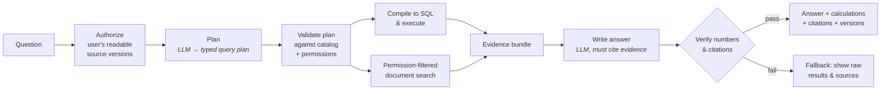

# Operations Copilot

**A governed AI copilot for operational data and company knowledge.**

Employees ask questions in plain language. Operations Copilot answers with numbers computed from approved datasets, passages cited from approved documents, and the exact source versions used, drawing only on sources each employee is authorized to see.

[](https://github.com/ivky03/operations-copilot/actions/workflows/ci.yml)

---

## The problem

Teams want to ask questions like *"Compare last month's net revenue by region, and what's our policy on refunds after 30 days?"* and get an answer they can trust. A general-purpose chatbot connected to company data tends to fail in predictable ways:

- **It invents or miscalculates numbers.** Language models are not calculators, and they don't know the business's metric definitions.
- **It leaks restricted information** when access control lives in the UI rather than in the data layer.
- **It can't show its work.** There's no record of which dataset version or policy revision an answer relied on.
- **It goes stale.** Cached answers survive after the underlying source is updated, revoked or deleted.

Operations Copilot is designed around those failure modes.

## Domain-agnostic by design

Nothing in the engine is specific to one industry:

- **Datasets are registered, not hard-coded.** A data steward uploads a table with a manifest that declares its columns, relationships to other tables, value aliases, and governed metric definitions (for example, `net_revenue` or `on_time_delivery_rate`).
- **Documents are any approved text:** policies, procedures, metric definitions, runbooks.
- **Access is managed per group and per source,** independent of subject matter.

The repository ships a **synthetic online-retail reference dataset** (transactions, products, stores, returns, plus policy documents). It was chosen because it produces realistic, verifiable questions, and it deliberately includes hard cases: cancellations, missing values, ambiguous names, superseded policies and restricted documents. The same engine can serve logistics, HR, finance or healthcare operations by registering different sources.

## How an answer is produced

The language model **interprets** the question and **phrases** the answer. Code does everything else: it authorizes, computes and verifies.



## Design principles

1. **Numbers come from SQL, never from the model.** The model outputs a typed query plan over registered tables and governed metrics. Code validates it and compiles it to parameterized SQL. A post-generation check rejects any number in the answer that isn't present in the computed results.
2. **Authorization is enforced in the data layer.** Every search, query, download, cache lookup and notification is filtered by the requesting user's current permissions, including the *schema descriptions* the model sees. Hiding a button is not access control.
3. **Every answer is pinned to source versions.** Publishing a new version changes what new answers use and invalidates affected caches. Historical answers keep a record of the versions they relied on.
4. **Deletion and revocation propagate.** Removed or revoked sources must not resurface through search, cached answers, notifications or saved conversation context. Background jobs check tombstones so they can't recreate deleted content.
5. **Clarify or abstain instead of guessing.** Ambiguous references ("the lamp" when several products match) trigger a clarifying question. Questions the data can't answer are acknowledged as unanswerable.
6. **A fixed pipeline, not an autonomous agent.** Each question takes a bounded number of model calls (2–3), keeping latency and cost predictable and each stage testable.
7. **Measured, not claimed.** Quality is reported from versioned evaluation runs, with mocked workflow tests kept separate from real model evaluations.

## Architecture

| Component | Technology | Role |
|---|---|---|
| Web app | React, TypeScript, Vite | Chat, citation and evidence views, steward and admin consoles. Served from the API's origin. |
| API | Python, FastAPI, Pydantic | Authentication, authorization, answer pipeline, source management |
| Database | PostgreSQL 16, pgvector, pg_trgm | Application data, versioned dataset tables, document chunks and embeddings, full-text and fuzzy search, jobs, chat history |
| Object storage | S3 (Floci emulator locally) | Uploaded source files, one object per version |
| Job queue | SQS + dead-letter queue (Floci locally) | Asynchronous validation, loading, chunking and embedding, with idempotent workers |
| Models | Groq (primary), Gemini (fallback); local CPU embeddings | Query planning and answer writing; semantic search without a GPU |
| Observability | Structured logs, telemetry tables, OpenTelemetry | Per-answer traces, latency, token and cost accounting |

A single-host deployment is a deliberate scope choice. Its limitations (no high availability, vertical scaling only, recovery point equal to the backup interval) will be documented alongside any deployment.

## Roadmap

| Area | Scope |
|---|---|
| Foundation | Local infrastructure, health checks, migrations, CI, cost guardrail |
| Reference data | Synthetic dataset generator with an independent oracle for expected answers |
| Access control | Sessions, groups and roles, source permissions, data catalog |
| Structured Q&A | Typed query plans, SQL compilation, value grounding, numeric verification |
| Document Q&A | Hybrid retrieval (full-text + vector), citations with versions |
| Combined answers & conversations | Data + documents in one answer, follow-ups, persistent chats |
| Ingestion pipeline | Steward uploads, validation, preview, publish, retries |
| Source lifecycle | Versioning, cache invalidation, notifications, deletion and revocation |
| Scale experiments | ~50 tables / ~120 documents; full vs retrieved schema context, measured |
| Reliability & cost | Budgets, rate limits, tracing, failure-injection and recovery drills |

## Evaluation

Each capability is evaluated separately, and results are published in `evals/reports/` with the model, prompt version, dataset stage, cost and latency recorded:

| Area | What is measured |
|---|---|
| Calculations | Plan correctness; numeric answers vs an independent pandas oracle |
| Value grounding | Correct resolution of names and aliases, or a correct clarifying question |
| Document retrieval | Recall@k, MRR, citation support |
| Combined answers & follow-ups | Both parts correct; context carried across turns |
| Ambiguous / unanswerable | Clarifies or abstains instead of fabricating |
| Permission boundaries | Zero restricted content in answers, search, caches, notifications or model prompts (hard gate) |
| Failure recovery | Worker crashes, duplicate messages, restarts, backup restore |

Deterministic tests (unit, integration, and mocked-model workflow tests) run in CI on every pull request; this includes the retrieval evaluation, which uses local embeddings and fails the build if search quality regresses. Model-quality evaluations of answers run separately against real models:

```bash
cd backend
uv run python -m evals.run_retrieval_eval   # seconds; deterministic
uv run python -m evals.run_answer_eval      # ~25 min on free tiers; results vary between runs
uv run python -m evals.run_answer_eval --golden stage_a.heldout   # questions never used for tuning
```
Held-out questions (`evals/golden/stage_a.heldout.yaml`) are committed before the change they measure, so a change can't be tuned to them.
 **No result is claimed before it has been measured.**

## Running locally

Prerequisites: Docker Desktop, [uv](https://docs.astral.sh/uv/), Node 22 (`frontend/.nvmrc`; run `nvm use` in `frontend/`).

```bash
cp .env.example .env                  # then add GROQ_API_KEY (free tier) to ask questions
docker compose up -d                  # Postgres (host port 5433) + Floci S3/SQS emulator (4566)

cd backend
uv sync                               # install Python dependencies exactly as locked
uv run alembic upgrade head           # apply database migrations
uv run python -m app.cli seed-reference     # groups, demo users (passwords printed once), sources
uv run python -m app.cli publish-reference  # validate, load and publish the reference dataset
                                      # (first run downloads the ~64 MB local embedding model)
uv run pytest                         # unit, integration and end-to-end tests
uv run uvicorn app.main:app --reload --port 8010  # API on http://localhost:8010

# In a second terminal
cd frontend && nvm use && npm ci && npm run dev  # web app on http://localhost:5173
```

`GET /health` returns `200` when the API can reach PostgreSQL and the S3/SQS emulator, and `503` with per-dependency status otherwise. The application refuses to start if it's configured to target real AWS without an explicit `ALLOW_REAL_AWS=true`.

## Repository layout

```
backend/            FastAPI application, migrations, tests
frontend/           React + TypeScript web app
.github/workflows/  CI pipeline
docker-compose.yml  Local PostgreSQL and AWS emulator
```

---

*All data in this repository is synthetic. Company names, transactions and documents are fictional.*
